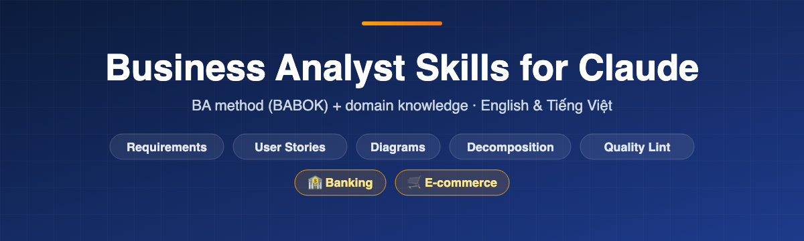

<div align="center">

<a href="https://lechithinh.github.io/ba-claude-skills/"></a>

# Business Analyst Skills for Claude

**Claude skills for Business Analysts: requirements analysis, user stories with Gherkin acceptance criteria, functional decomposition, BPMN/UML diagrams in Mermaid, plus Banking & E-commerce domain knowledge.** BABOK-aligned. English & Tiếng Việt.

[](https://github.com/lechithinh/ba-claude-skills/stargazers)
[](https://github.com/lechithinh/ba-claude-skills/releases)
[](#quick-start)
[](https://github.com/lechithinh/ba-claude-skills/commits/main)
[](LICENSE)

[**Website**](https://lechithinh.github.io/ba-claude-skills/) · [**Tiếng Việt**](README.vi.md) · [Examples](examples/domain-showcase/README.md) · [Changelog](CHANGELOG.md)

</div>

## Quick start

In Claude Code:

```bash
/plugin marketplace add lechithinh/ba-claude-skills
/plugin install ba-claude-skills@ba-claude-skills
```

Other ways to install:

- **Manual (Claude Code):** `git clone https://github.com/lechithinh/ba-claude-skills.git && cp -r ba-claude-skills/skills/* ~/.claude/skills/`
- **Claude.ai:** download skill zips from [Releases](https://github.com/lechithinh/ba-claude-skills/releases) and upload them in **Settings → Capabilities → Skills**. Upload a method skill *and* the domain pack you need.
- **Cursor, Codex, Gemini CLI and other agents:** point the agent to [`AGENTS.md`](AGENTS.md).

Then just ask: *"Write user stories with acceptance criteria for interbank transfer in our mobile banking app."*

## Who is this for

- **Business Analysts & Product Owners** who want stakeholder-ready output, not generic AI text.
- **BAs moving into a new domain** (banking, e-commerce) who need to know *what to ask*.
- **BA teams & trainers** who want a shared, BABOK-aligned way of working with AI.

## Watch a process run, and see the bug a diagram hides

A BPMN diagram can look perfect and still hide a bug. [`bpmn-modeling`](skills/bpmn-modeling/SKILL.md) doesn't just draw: it **runs tokens through scenarios** and shows exactly where the process gets stuck.

<p align="center"></p>

**AS-IS: it looks fine.** Scenario A (payment succeeds) runs end to end. Scenario E ("the payment gateway never replies") leaves the token **stuck forever** on *Receive payment result*. In real life that means a hanging order and a customer who may already have been charged.

<p align="center"></p>

**TO-BE: the fix.** The skill proposes a **5-minute timer** on the waiting task. When it fires, the token takes the exception path to *Order awaiting reconciliation* (an Operations step) instead of waiting forever. Every symbol choice comes with *why this one, and why not the alternative*.

## Why it's different

AI already knows *how to write* a requirement. A senior BA knows **what to ask** in a specific business domain. This repo packages both:

| | AI without context | **With BA Claude Skills** |
|---|---|---|
| Method | Free-form text | BABOK techniques, IDs, traceability, quality score |
| Domain | Generic happy path | Domain packs add rules, edge cases and questions for **Banking** and **E-commerce** |
| Unknown business values | Often invented | Left as a `[to confirm]` placeholder plus an open-questions list |
| Diagrams | Often fail to render | Mermaid with a render-safety checklist |
| Language | English-first | English & Vietnamese, with Vietnam context (NAPAS, eKYC, COD, e-invoice) |

### Same prompt, with and without a domain pack

*"Write a user story with acceptance criteria for interbank transfer on mobile banking."* Compared: AI without context vs `user-story-writer` + `domain-banking`.

| Scenario | AI without context | With domain pack | Why it matters |
|---|:-:|:-:|---|
| Successful transfer | ✅ | ✅ with beneficiary name inquiry | Showing the account name before confirming prevents sending money to the wrong person |
| Insufficient balance | ✅ | ✅ including fee | The balance may cover the amount but not amount + fee |
| Beneficiary not found / account closed | ❌ | ✅ | The customer must be stopped before authentication, not after |
| Per-transaction & daily limits | ❌ | ✅ | Limits differ by channel and customer segment and must be configurable |
| Biometric authentication above threshold | ❌ | ✅ | Regulatory requirement in Vietnam; thresholds are confirmed with Compliance |
| **Timeout → pending → reconciliation → auto-refund** | ❌ | ✅ | Unhandled timeouts are a classic source of production incidents and complaints |
| Duplicate submission (idempotency) | ❌ | ✅ | A double tap or network retry must never debit the customer twice |
| **Total** | **2 scenarios** | **7 scenarios + 5 open questions** | Open questions go to Compliance & Operations instead of being guessed |

→ Full outputs: [banking transfer](examples/domain-showcase/banking-interbank-transfer.md) · [e-commerce order cancellation](examples/domain-showcase/ecommerce-cancel-order.md)

## What's inside

**Method skills: how a BA works**

| Skill | Output |
|---|---|
| [`meeting-to-requirements`](skills/meeting-to-requirements/SKILL.md) | Transcript → goals, functional & non-functional requirements, business rules, open questions, each traced to a quote |
| [`requirements-linter`](skills/requirements-linter/SKILL.md) | 0 to 10 quality score per requirement; flags vague, untestable, compound and **missing domain scenarios**; rewrites them |
| [`functional-decomposition`](skills/functional-decomposition/SKILL.md) | System → modules → features → functions, Mermaid tree, CRUD gap check |
| [`user-story-writer`](skills/user-story-writer/SKILL.md) | INVEST user stories, Gherkin acceptance criteria with error paths, Jira CSV |
| [`bpmn-modeling`](skills/bpmn-modeling/SKILL.md) | BPMN 2.0 from a description: Mermaid, `.bpmn`, SVG, **token-run simulation** that finds stuck scenarios, lint, AS-IS → TO-BE |
| [`ba-diagrams`](skills/ba-diagrams/SKILL.md) | Swimlane process, use case, sequence, ERD, state and context diagrams in Mermaid |
| [`screen-spec`](skills/screen-spec/SKILL.md) | Screen specification from a mockup image: field table, validations, button behaviour, states, open questions (what is seen vs assumed) |
| [`decision-table`](skills/decision-table/SKILL.md) | Business rules to a decision table; a script finds **missing**, **conflicting** and **overlapping** rule combinations and generates tests |
| [`edge-case-finder`](skills/edge-case-finder/SKILL.md) | "What if…" review of a requirement: a short prioritised list of edge cases with questions per stakeholder and Gherkin AC |
| [`api-spec`](skills/api-spec/SKILL.md) | Draft API contract from requirements: endpoint table, business error codes, OpenAPI 3.0 YAML |

**Domain packs: what a BA must know**

| Pack | Covers |
|---|---|
| [`domain-banking`](skills/domain-banking/SKILL.md) | eKYC onboarding, accounts, transfers (internal / NAPAS / CITAD), cards, lending, deposits, disputes |
| [`domain-ecommerce`](skills/domain-ecommerce/SKILL.md) | Catalog, pricing & vouchers, checkout, payment, orders, fulfillment, shipping & COD, returns, marketplace settlement |
| [`domain-payments`](skills/domain-payments/SKILL.md) | E-wallet, payment gateway/PSP, QR, top-up, withdrawal, refund and chargeback, settlement, reconciliation |
| [`domain-lending`](skills/domain-lending/SKILL.md) | Consumer loans and BNPL: origination, decisioning, interest methods, repayment allocation, collections by DPD |
| [`domain-logistics`](skills/domain-logistics/SKILL.md) | Parcel delivery and warehouse: last mile, failed delivery, COD remittance, volumetric weight, WMS basics |

Each pack contains a glossary, processes, business-rule patterns, **a BA question checklist**, a data model with status sets, integrations, regulatory touchpoints and KPIs. Every method skill also ships a `LEARN.md` that teaches the technique behind it.

## How to use

Describe the task **and the business context**. Claude loads the right method skill and domain pack automatically.

| When | Say |
|---|---|
| After a stakeholder meeting | *"Extract requirements from this transcript. Context: e-wallet top-up in a bank app."* |
| Before BRD sign-off | *"Lint section 3 of this BRD for a marketplace checkout."* |
| New project | *"Functional decomposition for a digital lending app."* |
| Sprint refinement | *"User stories with Gherkin for returns & refunds in our online store."* |
| Status design | *"State diagrams for order, payment and shipment, and how they affect each other."* |

## FAQ

<details><summary><b>Do I need to call skills by name?</b></summary>
No. Describe the task and the context ("mobile banking", "marketplace"). Claude picks the skills from their descriptions.
</details>

<details><summary><b>Will it invent business rules or regulations?</b></summary>
The skills are instructed not to. Unknown values become <code>[to confirm]</code> placeholders plus open questions. Regulation files are community drafts with a "last reviewed" date. Use them to know what to ask Compliance or Legal; they are not legal advice.
</details>

<details><summary><b>Does it work in Vietnamese?</b></summary>
Yes. Skills reply in your language, and the domain packs include English-Vietnamese glossaries and Vietnam-specific context.
</details>

<details><summary><b>My domain isn't covered. Can I add it?</b></summary>
Yes. Copy <a href="templates/DOMAIN_TEMPLATE/SKILL.md"><code>templates/DOMAIN_TEMPLATE</code></a> and follow <a href="CONTRIBUTING.md">CONTRIBUTING.md</a>. Domain maintainers are credited.
</details>

<details><summary><b>Is my data sent anywhere?</b></summary>
Skills are plain Markdown instructions. Your data goes only to the AI tool you already use, under that tool's terms.
</details>

## Roadmap

**Domain packs next:** Insurance · Healthcare · HR
**Method skills next:** UAT test cases · traceability matrix · change-impact analysis · data mapping

[Full roadmap](ROADMAP.md) · [Request a skill or domain](https://github.com/lechithinh/ba-claude-skills/issues/new?template=skill_request.md)

## Contributing

Practitioner domain knowledge is the most valuable contribution. If you work as a BA in banking, e-commerce, insurance, logistics or healthcare, read [CONTRIBUTING.md](CONTRIBUTING.md) and become a **domain maintainer**.

## Author

Built by **[Le Chi Thinh](https://github.com/lechithinh)**, a Business Analyst sharing practical BA + AI workflows. If this saves you time, please ⭐ star the repo so other BAs can find it.

[](https://star-history.com/#lechithinh/ba-claude-skills&Date)

[MIT License](LICENSE)
