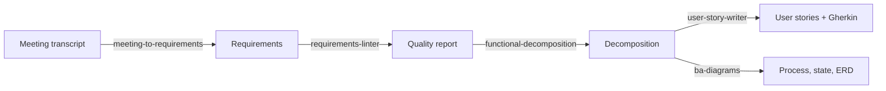

<div align="center">

# 🧩 BA Claude Skills

**From meeting notes to requirements, user stories and diagrams — Claude skills for Business Analysts.**

BABOK-aligned · English & Tiếng Việt · Works in Claude Code, Claude.ai and other AI agents

[](https://github.com/lechithinh/ba-claude-skills/stargazers)
[](LICENSE)
[](#-skills)
[](CONTRIBUTING.md)

**English** · [Tiếng Việt](README.vi.md)

</div>

---

## Why this repo?

Generic prompts give generic BA output: vague requirements, happy-path-only user stories, diagrams that don't render. These skills encode **how an experienced Business Analyst actually works** — the checks, the structure, the questions to ask — so Claude produces work you can put in front of stakeholders.

| Plain prompt | With BA Claude Skills |
|---|---|
| "The system should be fast and easy to use." ✅ looks fine | ❌ Flagged: *vague (fast, easy), not testable, compound* → rewritten into 2 measurable NFRs + questions for the stakeholder |
| A list of features | A numbered **functional decomposition** with a CRUD coverage check that finds missing functions |
| User stories with one happy path | **INVEST-checked** stories with **Gherkin** acceptance criteria, error paths and business-rule traceability |

## 🧰 Skills

| Skill | What it does | Try saying |
|---|---|---|
| [**meeting-to-requirements**](skills/meeting-to-requirements/SKILL.md) | Transcript / notes → goals, FR, NFR, business rules, open questions, action items — each traced to a quote | *"Extract requirements from this meeting transcript"* |
| [**requirements-linter**](skills/requirements-linter/SKILL.md) ⭐ | Scores each requirement, flags ambiguity / untestable / compound statements, rewrites them | *"Lint these requirements"* |
| [**functional-decomposition**](skills/functional-decomposition/SKILL.md) | System → modules → features → functions, Mermaid tree, CRUD gap check | *"Functional decomposition for a clinic booking app"* |
| [**user-story-writer**](skills/user-story-writer/SKILL.md) | INVEST user stories + Gherkin AC, splitting, Jira CSV | *"Write user stories for function 1.1"* |
| [**ba-diagrams**](skills/ba-diagrams/SKILL.md) | Picks the right model and draws it in Mermaid: swimlane process, use case, sequence, ERD, state, context | *"Draw the To-Be booking process as a swimlane"* |

Every skill ships with a **`LEARN.md`** explaining the BA technique behind it (BABOK references, common mistakes, practice exercise).

## 🔗 End-to-end example

See the full case study in [`examples/clinic-booking`](examples/clinic-booking/README.md):



## 🚀 Install

### Claude Code (recommended)
```bash
/plugin marketplace add lechithinh/ba-claude-skills
/plugin install ba-claude-skills@ba-claude-skills
```
Then just describe your task — Claude loads the matching skill automatically.

### Manual (Claude Code)
```bash
git clone https://github.com/lechithinh/ba-claude-skills.git
cp -r ba-claude-skills/skills/* ~/.claude/skills/
```

### Claude.ai (web / desktop)
1. Download a skill zip from [Releases](https://github.com/lechithinh/ba-claude-skills/releases) (or zip a folder under `skills/` yourself).
2. In Claude.ai open **Settings → Capabilities → Skills** and upload the zip.

### Other AI agents (Cursor, Codex, Gemini CLI…)
Each `SKILL.md` is plain Markdown. Point your agent at [`AGENTS.md`](AGENTS.md) or paste a skill into your project rules.

## 🗺️ Roadmap

Organized by BABOK knowledge area — see [ROADMAP.md](ROADMAP.md). Coming next: stakeholder map, BPMN As-Is/To-Be analysis, gap analysis, NFR checklist, traceability matrix, UAT test case generator, BRD/SRS writer.

👉 Want a skill? [Open a skill request](https://github.com/lechithinh/ba-claude-skills/issues/new?template=skill_request.md).

## 🤝 Contributing

BAs, POs and QA engineers are welcome! Read [CONTRIBUTING.md](CONTRIBUTING.md) and start from [`templates/SKILL_TEMPLATE.md`](templates/SKILL_TEMPLATE.md).

## 👤 Author

Built by **[Le Chi Thinh](https://github.com/lechithinh)** — Business Analyst sharing practical BA + AI workflows.

If this repo saves you time, please ⭐ **star it** — it helps other BAs find it.

[](https://star-history.com/#lechithinh/ba-claude-skills&Date)

## License

[MIT](LICENSE)
