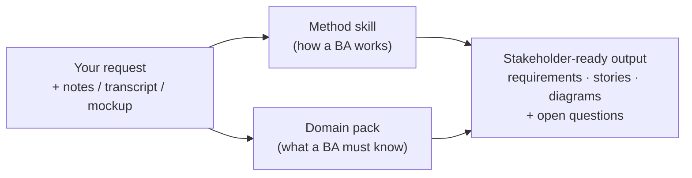

<div align="center">

# 🧩 BA Claude Skills

### AI skills for Business Analysts that **know your business domain**.

BA method (BABOK) **+** domain knowledge (Banking, E-commerce) **+** English & Tiếng Việt

[](https://github.com/lechithinh/ba-claude-skills/stargazers)
[](LICENSE)
[](#-method-skills--how-a-ba-works)
[](#-domain-packs--what-a-ba-must-know)
[](CONTRIBUTING.md)

**English** · [Tiếng Việt](README.vi.md)

</div>

---

## The problem

AI can already write a user story. But a user story for a **bank transfer** that forgets *timeouts, limits and reconciliation*, or an **order cancellation** rule that forgets *vouchers, COD and split orders*, is exactly the kind of gap that turns into a production incident or a failed UAT.

Generic AI knows *how to write*. A senior BA knows **what to ask** in a specific domain. This repo packages both.

## What makes this repo different

| | Generic prompts | Typical AI skill collections | **BA Claude Skills** |
|---|:-:|:-:|:-:|
| Structured BA method (BABOK techniques, IDs, traceability) | ❌ | ✅ | ✅ |
| Quality gate: scores & rewrites weak requirements | ❌ | ⚠️ rare | ✅ `requirements-linter` |
| **Domain knowledge packs** (rules, processes, data model, integrations, regulations, BA checklists) | ❌ | ❌ | ✅ **Banking · E-commerce** |
| Vietnam context (NAPAS/CITAD, eKYC, COD, e-invoice, local regulations) | ❌ | ❌ | ✅ |
| Bilingual output (EN / VI) | ⚠️ | ❌ | ✅ |
| Teaches the technique (`LEARN.md` per skill) | ❌ | ❌ | ✅ |
| End-to-end example you can inspect | ❌ | ⚠️ | ✅ |

## See the difference

Same prompt — *"Write a user story with acceptance criteria for interbank transfer on mobile banking"*:

<table>
<tr><th width="50%">❌ Generic</th><th width="50%">✅ <code>user-story-writer</code> + <code>domain-banking</code></th></tr>
<tr><td valign="top">

- Successful transfer
- Insufficient balance

**2 scenarios.**

</td><td valign="top">

- Successful transfer **with name inquiry**
- Beneficiary not found / account closed
- **Per-transaction & daily limit** exceeded
- **Biometric authentication above threshold**
- **Switch timeout → Pending → reconciliation → auto-refund**
- **Duplicate submission (idempotency)**
- Fee not covered by balance
- \+ 5 open questions for Compliance & Operations

**7 scenarios + questions.**

</td></tr>
</table>

👉 Full outputs: [banking transfer](examples/domain-showcase/banking-interbank-transfer.md) · [e-commerce order cancellation](examples/domain-showcase/ecommerce-cancel-order.md)

## How it works



Claude loads the **method skill** for the task and the **domain pack** for the context — automatically, from what you write. Domain packs use progressive disclosure: only the relevant reference file is read, so context stays small.

## 🧰 Method skills — *how a BA works*

| Skill | What you get | Try saying |
|---|---|---|
| [**meeting-to-requirements**](skills/meeting-to-requirements/SKILL.md) | Transcript → goals, FR, NFR, business rules, open questions, action items — each traced to a quote | *"Extract requirements from this meeting transcript"* |
| [**requirements-linter**](skills/requirements-linter/SKILL.md) ⭐ | 0–10 score per requirement, flags vague / untestable / compound / **missing domain scenarios**, rewrites them | *"Lint these requirements"* |
| [**functional-decomposition**](skills/functional-decomposition/SKILL.md) | System → modules → features → functions, Mermaid tree, CRUD gap check | *"Functional decomposition for a mobile banking app"* |
| [**user-story-writer**](skills/user-story-writer/SKILL.md) | INVEST stories + Gherkin AC with error paths, story splitting, Jira CSV | *"Write user stories for checkout"* |
| [**ba-diagrams**](skills/ba-diagrams/SKILL.md) | Right diagram for the question, in valid Mermaid: swimlane, use case, sequence, ERD, state, context | *"Draw the order state diagram"* |

## 🏦 Domain packs — *what a BA must know*

| Pack | Covers | Inside |
|---|---|---|
| [**domain-banking**](skills/domain-banking/SKILL.md) | Retail & digital banking: eKYC onboarding, accounts, transfers (internal / NAPAS / CITAD), cards, lending, term deposits, disputes, EOD | Glossary (40+ terms EN–VI) · processes & capability map · business-rule patterns (limits, auth thresholds, cut-off, timeout/pending, maker-checker) · data model & status sets · integration landscape · regulations · **BA checklist** · KPIs |
| [**domain-ecommerce**](skills/domain-ecommerce/SKILL.md) | Online stores & marketplaces: catalog, pricing & vouchers, cart & checkout, payment, OMS, fulfillment, shipping & COD, returns & refunds, seller settlement | Glossary · processes · business-rule patterns (stacking, reservation, split orders, refund routing) · data model & status sets · integrations (payment, carriers, e-invoice, marketplaces) · regulations · **BA checklist** · KPIs |

Each pack's `references/checklist.md` is the "questions a senior BA in this domain always asks" — the part juniors don't know to ask.

> ⚠️ Regulation files are community drafts with a *last reviewed* date. They tell you **what to ask Compliance/Legal** — they are not legal advice.

## 🚀 Install

**Claude Code** (recommended)
```bash
/plugin marketplace add lechithinh/ba-claude-skills
/plugin install ba-claude-skills@ba-claude-skills
```

**Manual**
```bash
git clone https://github.com/lechithinh/ba-claude-skills.git
cp -r ba-claude-skills/skills/* ~/.claude/skills/
```

**Claude.ai** — zip a folder under `skills/` (e.g. `skills/domain-banking`) and upload it in **Settings → Capabilities → Skills**. Upload a method skill *and* the domain pack you need.

**Cursor, Codex, Gemini CLI…** — see [`AGENTS.md`](AGENTS.md).

## 🧭 How to use

You don't call skills by name — just describe the task and the domain. Mentioning the domain ("mobile banking", "marketplace", "ngân hàng", "sàn TMĐT") is what pulls in the domain pack.

### Recipes

| Situation | Say this | Skills used |
|---|---|---|
| After a stakeholder meeting | *"Extract requirements from this transcript. Context: e-wallet top-up for a bank."* + paste | meeting-to-requirements + domain-banking |
| Reviewing a BRD before sign-off | *"Lint section 3 of this BRD for a marketplace checkout."* + paste | requirements-linter + domain-ecommerce |
| Starting a new project | *"Functional decomposition for a digital lending app."* | functional-decomposition + domain-banking |
| Sprint refinement | *"Write user stories with Gherkin AC for return & refund on our online store."* | user-story-writer + domain-ecommerce |
| Designing statuses | *"Draw the state diagram for order, payment and shipment and how they affect each other."* | ba-diagrams + domain-ecommerce |
| Learning a new domain | *"I'm new to banking. Explain the transfer process and what I must ask stakeholders."* | domain-banking |

### Tips for best results
1. **Give context in one line**: business model, channel, actors (e.g. *"B2C fashion store, app + web, own warehouse, COD allowed"*).
2. **Paste real material**: transcripts, BRD sections, screenshots of mockups.
3. **Chain the skills**: transcript → requirements → lint → decomposition → stories → diagrams. See the [clinic booking case study](examples/clinic-booking/README.md).
4. **Answer the open questions** — the `[value — confirm]` placeholders are intentional: the skills never invent your business rules.

## 📚 Examples

| Example | Shows |
|---|---|
| [Domain showcase](examples/domain-showcase/README.md) | Same prompt with vs without a domain pack (banking, e-commerce) |
| [Clinic booking case study](examples/clinic-booking/README.md) | Full chain from a Vietnamese meeting transcript to requirements, lint report, decomposition, user stories and diagrams |

## 🗺️ Roadmap

**Next domain packs:** Payments & e-wallets · Insurance · Logistics · Healthcare
**Next method skills:** decision table · screen spec (from mockups) · API spec (OpenAPI) · UAT test cases · traceability matrix
Full list: [ROADMAP.md](ROADMAP.md) · [Request a skill or domain](https://github.com/lechithinh/ba-claude-skills/issues/new?template=skill_request.md)

## 🤝 Contributing — become a domain maintainer

Working as a BA in banking, e-commerce, insurance, logistics, healthcare…? Your domain knowledge is the most valuable contribution here. Domain maintainers are credited in the pack and in this README. Start with [CONTRIBUTING.md](CONTRIBUTING.md) and [`templates/DOMAIN_TEMPLATE`](templates/DOMAIN_TEMPLATE/SKILL.md).

## 👤 Author

Built by **[Le Chi Thinh](https://github.com/lechithinh)** — Business Analyst sharing practical BA + AI workflows.

If this repo helps you, ⭐ **star it** so other BAs can find it.

[](https://star-history.com/#lechithinh/ba-claude-skills&Date)

## License

[MIT](LICENSE)
