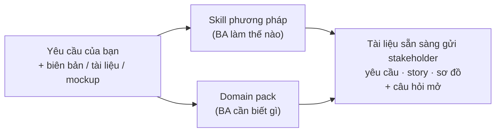

<div align="center">

# 🧩 BA Claude Skills

### Bộ skill AI cho Business Analyst **hiểu nghiệp vụ của bạn**.

Phương pháp BA (BABOK) **+** kiến thức nghiệp vụ (Ngân hàng, Thương mại điện tử) **+** Tiếng Việt & English

[](https://github.com/lechithinh/ba-claude-skills/stargazers)
[](LICENSE)
[](#-skill-phương-pháp--ba-làm-việc-thế-nào)
[](#-domain-pack--ba-cần-biết-gì)

[English](README.md) · **Tiếng Việt**

</div>

---

## Vấn đề

AI đã viết được user story. Nhưng một user story **chuyển tiền** quên *timeout, hạn mức, đối soát*, hay một rule **hủy đơn hàng** quên *voucher, COD, tách đơn* chính là lỗ hổng biến thành sự cố production hoặc UAT thất bại.

AI thông thường biết *cách viết*. BA giàu kinh nghiệm biết **cần hỏi gì** trong từng nghiệp vụ. Repo này đóng gói cả hai.

## Điểm khác biệt

| | Prompt thông thường | Bộ AI skill phổ biến | **BA Claude Skills** |
|---|:-:|:-:|:-:|
| Phương pháp BA có cấu trúc (BABOK, ID, truy vết) | ❌ | ✅ | ✅ |
| Kiểm tra chất lượng: chấm điểm & viết lại yêu cầu yếu | ❌ | ⚠️ hiếm | ✅ `requirements-linter` |
| **Domain pack kiến thức nghiệp vụ** (rule, quy trình, data model, tích hợp, pháp lý, checklist cho BA) | ❌ | ❌ | ✅ **Ngân hàng · TMĐT** |
| Bối cảnh Việt Nam (NAPAS/CITAD, eKYC, COD, hóa đơn điện tử, quy định trong nước) | ❌ | ❌ | ✅ |
| Song ngữ Việt / Anh | ⚠️ | ❌ | ✅ |
| Dạy luôn kỹ thuật (`LEARN.md` cho mỗi skill) | ❌ | ❌ | ✅ |
| Ví dụ end-to-end để kiểm chứng | ❌ | ⚠️ | ✅ |

## Thấy ngay sự khác biệt

Cùng một prompt — *"Viết user story kèm acceptance criteria cho chức năng chuyển tiền liên ngân hàng trên mobile banking"*:

<table>
<tr><th width="50%">❌ AI thông thường</th><th width="50%">✅ <code>user-story-writer</code> + <code>domain-banking</code></th></tr>
<tr><td valign="top">

- Chuyển tiền thành công
- Không đủ số dư

**2 kịch bản.**

</td><td valign="top">

- Chuyển thành công **có truy vấn tên người thụ hưởng**
- Tài khoản thụ hưởng không tồn tại / đã đóng
- **Vượt hạn mức giao dịch / ngày**
- **Xác thực sinh trắc học khi vượt ngưỡng**
- **Timeout → Đang xử lý → đối soát → tự hoàn tiền**
- **Bấm xác nhận 2 lần (chống trùng)**
- Số dư không đủ trả phí
- \+ 5 câu hỏi mở cho Compliance & Vận hành

**7 kịch bản + câu hỏi.**

</td></tr>
</table>

👉 Xem đầy đủ: [chuyển tiền ngân hàng](examples/domain-showcase/banking-interbank-transfer.md) · [hủy đơn hàng TMĐT](examples/domain-showcase/ecommerce-cancel-order.md)

## Cách hoạt động



Claude tự động nạp **skill phương pháp** theo công việc và **domain pack** theo bối cảnh bạn mô tả. Domain pack chỉ đọc đúng file tham chiếu cần thiết nên không tốn context.

## 🧰 Skill phương pháp — *BA làm việc thế nào*

| Skill | Bạn nhận được | Thử nói |
|---|---|---|
| [**meeting-to-requirements**](skills/meeting-to-requirements/SKILL.md) | Biên bản → mục tiêu, FR, NFR, business rule, câu hỏi mở, action item — có trích dẫn nguồn | *"Trích xuất yêu cầu từ biên bản họp này"* |
| [**requirements-linter**](skills/requirements-linter/SKILL.md) ⭐ | Chấm điểm 0–10 từng yêu cầu, phát hiện mơ hồ / không kiểm thử được / gộp / **thiếu kịch bản nghiệp vụ**, viết lại | *"Kiểm tra chất lượng các yêu cầu này"* |
| [**functional-decomposition**](skills/functional-decomposition/SKILL.md) | Hệ thống → module → tính năng → chức năng, sơ đồ cây, kiểm tra CRUD | *"Phân rã chức năng app mobile banking"* |
| [**user-story-writer**](skills/user-story-writer/SKILL.md) | Story chuẩn INVEST + AC Gherkin có kịch bản lỗi, tách story, CSV cho Jira | *"Viết user story cho bước checkout"* |
| [**ba-diagrams**](skills/ba-diagrams/SKILL.md) | Chọn đúng sơ đồ, vẽ Mermaid chuẩn: swimlane, use case, sequence, ERD, state, context | *"Vẽ sơ đồ trạng thái đơn hàng"* |

## 🏦 Domain pack — *BA cần biết gì*

| Pack | Phạm vi | Bên trong |
|---|---|---|
| [**domain-banking**](skills/domain-banking/SKILL.md) | Ngân hàng bán lẻ & số: eKYC, tài khoản, chuyển tiền (nội bộ / NAPAS / CITAD), thẻ, cho vay, tiền gửi, tra soát, EOD | Thuật ngữ Anh–Việt (40+) · quy trình & capability map · pattern business rule (hạn mức, ngưỡng xác thực, cut-off, timeout/pending, maker-checker) · data model & trạng thái · bản đồ tích hợp · pháp lý · **checklist câu hỏi BA** · KPI |
| [**domain-ecommerce**](skills/domain-ecommerce/SKILL.md) | Website bán hàng & sàn TMĐT: danh mục, giá & voucher, giỏ hàng & checkout, thanh toán, OMS, kho, vận chuyển & COD, đổi trả & hoàn tiền, đối soát seller | Thuật ngữ · quy trình · pattern business rule (cộng dồn KM, giữ hàng, tách đơn, kênh hoàn tiền) · data model & trạng thái · tích hợp (cổng thanh toán, hãng vận chuyển, hóa đơn điện tử, sàn) · pháp lý · **checklist câu hỏi BA** · KPI |

File `references/checklist.md` trong mỗi pack là *"những câu một BA lâu năm trong ngành luôn hỏi"* — đúng phần BA mới chưa biết để hỏi.

> ⚠️ File pháp lý là bản nháp cộng đồng, có ghi ngày review. Dùng để biết **cần hỏi Compliance/Pháp chế điều gì**, không phải tư vấn pháp lý.

## 🚀 Cài đặt

**Claude Code** (khuyến nghị)
```bash
/plugin marketplace add lechithinh/ba-claude-skills
/plugin install ba-claude-skills@ba-claude-skills
```

**Cài thủ công**
```bash
git clone https://github.com/lechithinh/ba-claude-skills.git
cp -r ba-claude-skills/skills/* ~/.claude/skills/
```

**Claude.ai** — nén một thư mục trong `skills/` (ví dụ `skills/domain-banking`) thành zip rồi upload ở **Settings → Capabilities → Skills**. Upload cả skill phương pháp *và* domain pack bạn cần.

**Cursor, Codex, Gemini CLI…** — xem [`AGENTS.md`](AGENTS.md).

## 🧭 Cách sử dụng

Không cần gọi tên skill — chỉ cần mô tả công việc và **nghiệp vụ**. Nhắc tới bối cảnh ("mobile banking", "sàn TMĐT", "ngân hàng", "website bán hàng") là Claude nạp domain pack tương ứng.

### Công thức theo tình huống

| Tình huống | Hãy nói | Skill được dùng |
|---|---|---|
| Sau buổi họp stakeholder | *"Trích xuất yêu cầu từ biên bản này. Bối cảnh: nạp tiền ví điện tử của ngân hàng."* + dán biên bản | meeting-to-requirements + domain-banking |
| Review BRD trước khi sign-off | *"Kiểm tra chất lượng mục 3 của BRD checkout cho sàn TMĐT."* + dán nội dung | requirements-linter + domain-ecommerce |
| Bắt đầu dự án mới | *"Phân rã chức năng cho app cho vay tiêu dùng online."* | functional-decomposition + domain-banking |
| Refinement sprint | *"Viết user story kèm Gherkin cho đổi trả & hoàn tiền của website bán hàng."* | user-story-writer + domain-ecommerce |
| Thiết kế trạng thái | *"Vẽ sơ đồ trạng thái đơn hàng, thanh toán, vận chuyển và ảnh hưởng qua lại."* | ba-diagrams + domain-ecommerce |
| Học domain mới | *"Mình mới chuyển sang ngân hàng. Giải thích quy trình chuyển tiền và những gì cần hỏi stakeholder."* | domain-banking |

### Mẹo để có kết quả tốt
1. **Cho bối cảnh trong một câu**: mô hình kinh doanh, kênh, đối tượng (ví dụ *"Shop thời trang B2C, app + web, kho riêng, có COD"*).
2. **Dán tài liệu thật**: biên bản họp, đoạn BRD, ảnh chụp mockup.
3. **Nối các skill**: biên bản → yêu cầu → kiểm tra → phân rã → story → sơ đồ. Xem [case study phòng khám](examples/clinic-booking/README.md).
4. **Trả lời câu hỏi mở** — các ô `[giá trị — xác nhận]` là cố ý: skill không bao giờ tự bịa business rule của bạn.

## 📚 Ví dụ

| Ví dụ | Nội dung |
|---|---|
| [Domain showcase](examples/domain-showcase/README.md) | Cùng prompt, có và không có domain pack (ngân hàng, TMĐT) |
| [Case study đặt lịch phòng khám](examples/clinic-booking/README.md) | Chuỗi đầy đủ từ biên bản họp tiếng Việt → yêu cầu → báo cáo chất lượng → phân rã → user story → sơ đồ |

## 🗺️ Lộ trình

**Domain pack tiếp theo:** Thanh toán & ví điện tử · Bảo hiểm · Logistics · Y tế
**Skill phương pháp tiếp theo:** decision table · đặc tả màn hình (từ mockup) · API spec (OpenAPI) · test case UAT · ma trận truy vết
Chi tiết: [ROADMAP.md](ROADMAP.md) · [Đề xuất skill hoặc domain](https://github.com/lechithinh/ba-claude-skills/issues/new?template=skill_request.md)

## 🤝 Đóng góp — trở thành domain maintainer

Bạn đang làm BA ngân hàng, TMĐT, bảo hiểm, logistics, y tế…? Kiến thức nghiệp vụ của bạn là đóng góp giá trị nhất. Domain maintainer được ghi tên trong pack và trong README. Bắt đầu với [CONTRIBUTING.md](CONTRIBUTING.md) và [`templates/DOMAIN_TEMPLATE`](templates/DOMAIN_TEMPLATE/SKILL.md).

## 👤 Tác giả

**[Lê Chí Thịnh](https://github.com/lechithinh)** — Business Analyst chia sẻ quy trình làm BA cùng AI.

Nếu repo hữu ích, hãy ⭐ **star** để nhiều BA khác tìm thấy.

## Giấy phép

[MIT](LICENSE)
