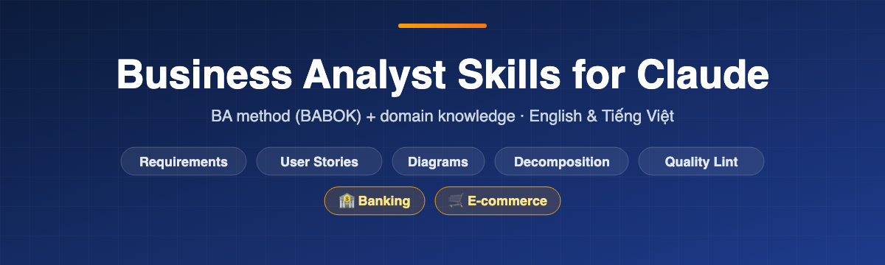

<div align="center">

<a href="https://lechithinh.github.io/ba-claude-skills/vi/"></a>

# Bộ Skill Claude cho Business Analyst

**Skill Claude dành cho BA: phân tích yêu cầu, viết user story kèm acceptance criteria (Gherkin), phân rã chức năng, vẽ sơ đồ BPMN/UML bằng Mermaid, cùng kiến thức nghiệp vụ Ngân hàng và Thương mại điện tử.** Theo chuẩn BABOK. Tiếng Việt & English.

[](https://github.com/lechithinh/ba-claude-skills/stargazers)
[](https://github.com/lechithinh/ba-claude-skills/releases)
[](#bắt-đầu-nhanh)
[](LICENSE)

[**Website**](https://lechithinh.github.io/ba-claude-skills/vi/) · [**English**](README.md) · [Ví dụ](examples/domain-showcase/README.md) · [Changelog](CHANGELOG.md)

</div>

## Bắt đầu nhanh

Trong [Claude Code](https://docs.claude.com/en/docs/claude-code):

```bash
/plugin marketplace add lechithinh/ba-claude-skills
/plugin install ba-claude-skills@ba-claude-skills
```

Sau đó chỉ cần nói: *"Viết user story kèm acceptance criteria cho chức năng chuyển tiền liên ngân hàng trên mobile banking."*
Dùng Claude.ai, Cursor hay Codex? Xem [cách cài khác](#cách-cài-khác).

## Dành cho ai

- **BA và Product Owner** cần tài liệu đủ chất lượng gửi stakeholder, không phải văn bản AI chung chung.
- **BA chuyển sang domain mới** (ngân hàng, TMĐT) cần biết *phải hỏi gì*.
- **Team BA và người đào tạo BA** muốn một cách làm việc với AI thống nhất, theo BABOK.

## Điểm khác biệt

AI đã biết *cách viết* một yêu cầu. BA lâu năm biết **cần hỏi gì** trong từng nghiệp vụ. Repo này đóng gói cả hai:

| | AI không có bối cảnh | **Có BA Claude Skills** |
|---|---|---|
| Phương pháp | Văn bản tự do | Kỹ thuật BABOK, ID, truy vết, chấm điểm chất lượng |
| Nghiệp vụ | Chỉ có happy path chung chung | Domain pack bổ sung rule, ngoại lệ và câu hỏi cho **Ngân hàng** và **TMĐT** |
| Giá trị nghiệp vụ chưa biết | Thường tự bịa | Để `[giá trị — xác nhận]` kèm danh sách câu hỏi mở |
| Sơ đồ | Hay lỗi không hiển thị | Mermaid có checklist chống lỗi render |
| Ngôn ngữ | Ưu tiên tiếng Anh | Việt & Anh, có bối cảnh Việt Nam (NAPAS, eKYC, COD, hóa đơn điện tử) |

### Cùng một prompt, có và không có domain pack

*"Viết user story kèm acceptance criteria cho chức năng chuyển tiền liên ngân hàng trên mobile banking."*

| Kịch bản | AI không có bối cảnh | `user-story-writer` + `domain-banking` | Vì sao quan trọng |
|---|:-:|:-:|---|
| Chuyển tiền thành công | ✅ | ✅ có truy vấn tên người thụ hưởng | Hiện tên chủ tài khoản trước khi xác nhận giúp tránh chuyển nhầm người |
| Không đủ số dư | ✅ | ✅ tính cả phí | Số dư có thể đủ cho số tiền nhưng không đủ cho số tiền + phí |
| Tài khoản thụ hưởng không tồn tại / đã đóng | ❌ | ✅ | Phải chặn trước bước xác thực, không phải sau đó |
| Hạn mức theo giao dịch & theo ngày | ❌ | ✅ | Hạn mức khác nhau theo kênh, phân khúc khách hàng và phải cấu hình được |
| Xác thực sinh trắc học khi vượt ngưỡng | ❌ | ✅ | Yêu cầu pháp lý tại Việt Nam; ngưỡng cần Compliance xác nhận |
| **Timeout → đang xử lý → đối soát → tự hoàn tiền** | ❌ | ✅ | Timeout không được xử lý là nguồn sự cố production và khiếu nại kinh điển |
| Bấm xác nhận 2 lần (chống trùng) | ❌ | ✅ | Bấm đúp hay app tự gửi lại không bao giờ được trừ tiền hai lần |
| **Tổng** | **2 kịch bản** | **7 kịch bản + 5 câu hỏi mở** | Câu hỏi mở được gửi cho Compliance & Vận hành thay vì tự đoán |

→ Xem đầy đủ: [chuyển tiền ngân hàng](examples/domain-showcase/banking-interbank-transfer.md) · [hủy đơn hàng TMĐT](examples/domain-showcase/ecommerce-cancel-order.md)

## Bên trong có gì

**Skill phương pháp: BA làm việc thế nào**

| Skill | Kết quả |
|---|---|
| [`meeting-to-requirements`](skills/meeting-to-requirements/SKILL.md) | Biên bản họp → mục tiêu, yêu cầu chức năng & phi chức năng, business rule, câu hỏi mở, có trích dẫn nguồn |
| [`requirements-linter`](skills/requirements-linter/SKILL.md) | Chấm điểm 0–10 từng yêu cầu; phát hiện mơ hồ, không kiểm thử được, gộp yêu cầu và **thiếu kịch bản nghiệp vụ**; đề xuất viết lại |
| [`functional-decomposition`](skills/functional-decomposition/SKILL.md) | Hệ thống → module → tính năng → chức năng, sơ đồ cây Mermaid, kiểm tra CRUD |
| [`user-story-writer`](skills/user-story-writer/SKILL.md) | User story chuẩn INVEST, AC Gherkin có kịch bản lỗi, CSV cho Jira |
| [`ba-diagrams`](skills/ba-diagrams/SKILL.md) | Sơ đồ quy trình swimlane, use case, sequence, ERD, trạng thái, context bằng Mermaid |

**Domain pack: BA cần biết gì**

| Pack | Phạm vi |
|---|---|
| [`domain-banking`](skills/domain-banking/SKILL.md) | eKYC, tài khoản, chuyển tiền (nội bộ / NAPAS / CITAD), thẻ, cho vay, tiền gửi, tra soát |
| [`domain-ecommerce`](skills/domain-ecommerce/SKILL.md) | Danh mục, giá & voucher, checkout, thanh toán, đơn hàng, kho, vận chuyển & COD, đổi trả, đối soát seller |

Mỗi pack gồm thuật ngữ Anh–Việt, quy trình, pattern business rule, **checklist câu hỏi cho BA**, data model kèm trạng thái, bản đồ tích hợp, điểm chạm pháp lý và KPI. Mỗi skill phương pháp có thêm file `LEARN.md` giải thích kỹ thuật BA phía sau.

## Cách sử dụng

Mô tả công việc **kèm bối cảnh nghiệp vụ**. Claude tự chọn skill phương pháp và domain pack phù hợp.

| Khi nào | Hãy nói |
|---|---|
| Sau buổi họp stakeholder | *"Trích xuất yêu cầu từ biên bản này. Bối cảnh: nạp tiền ví điện tử trong app ngân hàng."* |
| Trước khi sign-off BRD | *"Kiểm tra chất lượng mục 3 của BRD checkout cho sàn TMĐT."* |
| Dự án mới | *"Phân rã chức năng cho app cho vay tiêu dùng online."* |
| Refinement sprint | *"Viết user story kèm Gherkin cho đổi trả & hoàn tiền của website bán hàng."* |
| Thiết kế trạng thái | *"Vẽ sơ đồ trạng thái đơn hàng, thanh toán, vận chuyển và ảnh hưởng qua lại."* |

**Mẹo:** nêu mô hình kinh doanh trong một câu (*"Shop thời trang B2C, app + web, có COD"*), dán tài liệu thật, và nối các skill: biên bản → yêu cầu → kiểm tra → phân rã → story → sơ đồ. Xem [case study đặt lịch phòng khám](examples/clinic-booking/README.md).

## Cách cài khác

- **Cài thủ công (Claude Code):** `git clone https://github.com/lechithinh/ba-claude-skills.git && cp -r ba-claude-skills/skills/* ~/.claude/skills/`
- **Claude.ai:** tải file zip của skill ở [Releases](https://github.com/lechithinh/ba-claude-skills/releases) rồi upload tại **Settings → Capabilities → Skills**. Nên upload cả skill phương pháp *và* domain pack bạn cần.
- **Cursor, Codex, Gemini CLI và các agent khác:** trỏ agent tới [`AGENTS.md`](AGENTS.md).

## Câu hỏi thường gặp

<details><summary><b>Có cần gọi tên skill không?</b></summary>
Không. Chỉ cần mô tả công việc và bối cảnh ("mobile banking", "sàn TMĐT"). Claude tự chọn skill dựa trên mô tả của chúng.
</details>

<details><summary><b>Skill có tự bịa business rule hay quy định pháp luật không?</b></summary>
Skill được hướng dẫn không làm vậy. Giá trị chưa biết sẽ để dạng <code>[giá trị — xác nhận]</code> kèm câu hỏi mở. File pháp lý là bản nháp cộng đồng có ghi ngày review; hãy dùng để biết cần hỏi Compliance hay Pháp chế điều gì. Đây không phải tư vấn pháp lý.
</details>

<details><summary><b>Dùng tiếng Việt được không?</b></summary>
Được. Skill trả lời theo ngôn ngữ bạn dùng, và domain pack có thuật ngữ Anh–Việt cùng bối cảnh Việt Nam.
</details>

<details><summary><b>Domain của tôi chưa có, tôi đóng góp được không?</b></summary>
Được. Sao chép <a href="templates/DOMAIN_TEMPLATE/SKILL.md"><code>templates/DOMAIN_TEMPLATE</code></a> và làm theo <a href="CONTRIBUTING.md">CONTRIBUTING.md</a>. Domain maintainer được ghi tên.
</details>

<details><summary><b>Dữ liệu của tôi có bị gửi đi đâu không?</b></summary>
Skill chỉ là file hướng dẫn dạng Markdown. Dữ liệu của bạn chỉ đi tới công cụ AI bạn đang dùng, theo điều khoản của công cụ đó.
</details>

## Lộ trình

**Domain pack tiếp theo:** Thanh toán & ví điện tử · Bảo hiểm · Logistics · Y tế
**Skill phương pháp tiếp theo:** decision table · đặc tả màn hình từ mockup · API spec (OpenAPI) · test case UAT · ma trận truy vết

[Lộ trình đầy đủ](ROADMAP.md) · [Đề xuất skill hoặc domain](https://github.com/lechithinh/ba-claude-skills/issues/new?template=skill_request.md)

## Đóng góp

Kiến thức nghiệp vụ từ người làm thực tế là đóng góp giá trị nhất. Nếu bạn là BA ngân hàng, TMĐT, bảo hiểm, logistics hay y tế, hãy đọc [CONTRIBUTING.md](CONTRIBUTING.md) và trở thành **domain maintainer**.

## Tác giả

**[Lê Chí Thịnh](https://github.com/lechithinh)**, Business Analyst chia sẻ quy trình làm BA cùng AI. Nếu repo giúp bạn tiết kiệm thời gian, hãy ⭐ star để nhiều BA khác tìm thấy.

[Giấy phép MIT](LICENSE)
