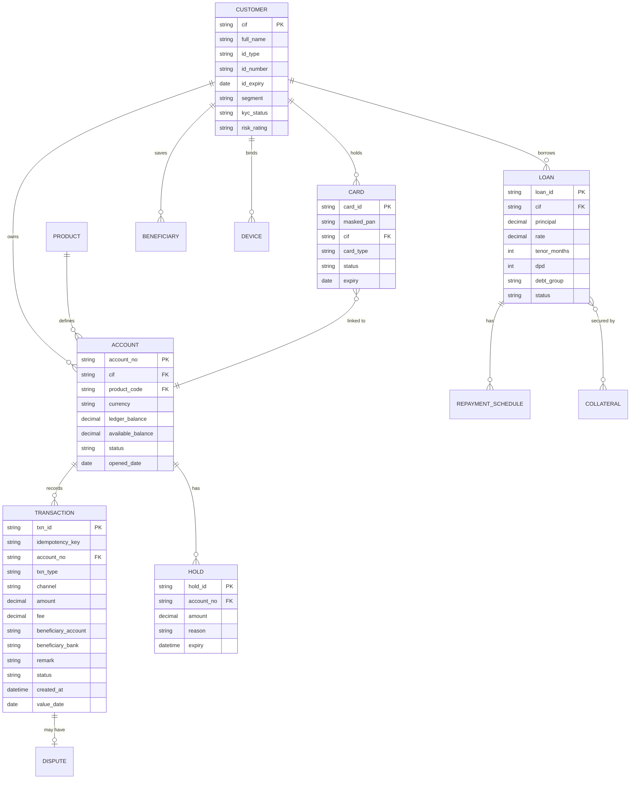


Use as a starting point for ERDs, data dictionaries and API payloads. Real core banking models are much larger.

## Status code sets to agree early

- **Account:** ACTIVE · DORMANT · DEBIT_BLOCKED · CREDIT_BLOCKED · BLOCKED · CLOSED
- **Transaction:** INITIATED · PENDING · SUCCESS · FAILED · REVERSED
- **Card:** INACTIVE · ACTIVE · LOCKED · BLOCKED · EXPIRED · CLOSED
- **Loan:** APPLIED · APPROVED · REJECTED · DISBURSED · ACTIVE · OVERDUE · SETTLED · WRITTEN_OFF
- **KYC:** PENDING · VERIFIED · MANUAL_REVIEW · REJECTED · EXPIRED

## Data sensitivity

| Data | Treatment |
|---|---|
| ID number, biometric images | Personal data (sensitive) — encryption, access control, retention policy |
| PAN (card number) | Mask everywhere; PCI DSS scope |
| Account number | Mask in notifications/logs where possible |
| Balances, transactions | Confidential; audit access |


---

**Use this with Claude:** install the plugin with `/plugin marketplace add lechithinh/ba-claude-skills`, or read the skill source on [GitHub](https://github.com/lechithinh/ba-claude-skills/blob/main/skills/domain-banking/SKILL.md).
