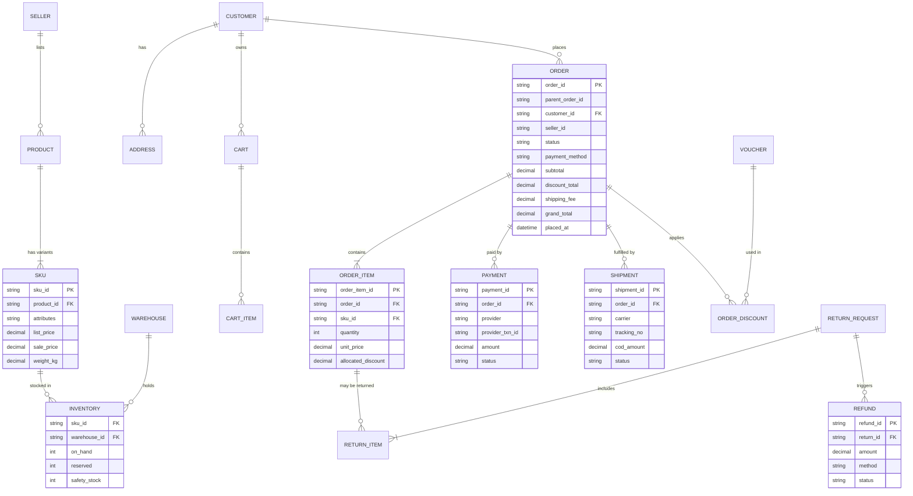



## Status sets to agree early

- **Order:** PENDING_PAYMENT · CONFIRMED · PROCESSING · READY_TO_SHIP · SHIPPING · DELIVERED · COMPLETED · CANCELLED · RETURNING · RETURNED
- **Payment:** PENDING · AUTHORIZED · PAID · FAILED · EXPIRED · PARTIALLY_REFUNDED · REFUNDED
- **Shipment:** CREATED · PICKED_UP · IN_TRANSIT · OUT_FOR_DELIVERY · DELIVERED · FAILED_ATTEMPT · RETURNING_TO_SENDER · RETURNED
- **Return:** REQUESTED · APPROVED · REJECTED · PICKED_UP · INSPECTING · REFUNDED · CLOSED

> Tip: draw a state diagram per object (`ba-diagrams`) and a mapping table showing how a shipment/payment event moves the order status.


---

**Use this with Claude:** install the plugin with `/plugin marketplace add lechithinh/ba-claude-skills`, or read the skill source on [GitHub](https://github.com/lechithinh/ba-claude-skills/blob/main/skills/domain-ecommerce/SKILL.md).
