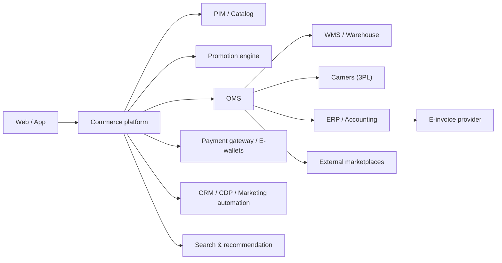



| Integration | Common options in Vietnam (examples) | BA questions |
|---|---|---|
| Payment gateway / e-wallet / QR | VNPAY, MoMo, ZaloPay, ShopeePay, OnePay, international card processors, VietQR bank transfer | Callback (IPN) handling? Expiry? Refund API? Fees? Reconciliation file? |
| Carriers | GHN, GHTK, Viettel Post, J&T Express, VNPost, Ahamove/Grab (on-demand) | Fee API? Status webhook mapping? COD remittance cycle? Failed delivery codes? |
| E-invoice | Licensed e-invoice providers | When to issue (on delivery/payment)? Adjust/replace invoice on return? Company vs individual buyer info? |
| ERP / accounting | SAP, Oracle, MISA, Odoo… | Sync frequency for orders, stock, prices? Master data owner? |
| External marketplaces | Shopee, Lazada, TikTok Shop, Tiki | Stock sync to avoid oversell across channels? Order import? |
| CRM / CDP / messaging | Zalo OA/ZNS, email, push | Consent, templates, triggers (abandoned cart, shipped)? |
| Search | Elasticsearch/OpenSearch, SaaS search | Synonyms (Vietnamese with/without diacritics), ranking rules? |

## Error-handling questions for every integration
1. Which system is the **source of truth** (stock, price, order status)?
2. Sync mode: real-time API, webhook, or batch? Acceptable delay?
3. What happens when the partner is down (carrier API, payment gateway)?
4. How are partner status codes mapped to our statuses?
5. Daily reconciliation: who checks mismatches and how?


---

**Use this with Claude:** install the plugin with `/plugin marketplace add lechithinh/ba-claude-skills`, or read the skill source on [GitHub](https://github.com/lechithinh/ba-claude-skills/blob/main/skills/domain-ecommerce/SKILL.md).
