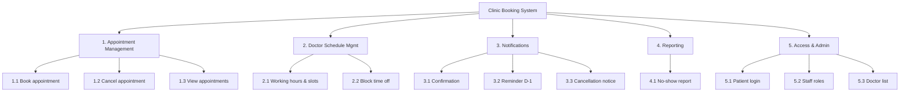


> Prompt used: *"Phân rã chức năng hệ thống từ các yêu cầu đã chốt"*

## Functional Decomposition — Clinic Booking System

**Scope:** đặt/hủy lịch khám, nhắc lịch, quản lý lịch bác sĩ, báo cáo no-show · **Actors:** Patient, Receptionist, Doctor, Clinic Manager · **Out of scope (phase 1):** thanh toán đặt cọc (chờ Q1), Zalo

### Hierarchy

| ID | Function | Actor(s) | Trace |
|----|----------|----------|-------|
| 1 | **Appointment Management** | | |
| 1.1 | Book appointment | | |
| 1.1.1 | Search available slots by doctor & date | Patient, Receptionist | FR-01 |
| 1.1.2 | Create booking (self-service) | Patient | FR-01, BR-02 |
| 1.1.3 | Create booking on behalf of patient | Receptionist | FR-04 |
| 1.1.4 | Prevent double booking | System | FR-08 |
| 1.2 | Cancel appointment | | |
| 1.2.1 | Cancel booking online | Patient | FR-03, BR-01 |
| 1.2.2 | Cancel booking on behalf of patient | Receptionist | gap → confirm |
| 1.3 | View appointments | | |
| 1.3.1 | View my upcoming appointments | Patient | gap → confirm |
| 1.3.2 | View daily schedule per doctor | Receptionist | FR-05 |
| 1.3.3 | Mark attendance (arrived / no-show) | Receptionist | needed for FR-07 |
| 2 | **Doctor Schedule Management** | | |
| 2.1 | Define working hours & slot length | Clinic Manager | gap → confirm |
| 2.2 | Block time off | Doctor | FR-06 |
| 3 | **Notifications** | | |
| 3.1 | Send booking confirmation | System | assumption |
| 3.2 | Send reminder D-1 (SMS) | System | FR-02 |
| 3.3 | Send cancellation notice | System | assumption |
| 4 | **Reporting** | | |
| 4.1 | Monthly no-show rate by doctor | Clinic Manager | FR-07 |
| 5 | **Access & Administration** | | |
| 5.1 | Patient register / login (OTP) | Patient | assumption |
| 5.2 | Staff login & roles | Receptionist, Doctor, Manager | assumption |
| 5.3 | Manage doctor list | Clinic Manager | gap → confirm |

### Diagram

### Coverage check — CRUD

| Object | Create | Read | Update | Delete / Cancel |
|--------|--------|------|--------|-----------------|
| Appointment | 1.1.2, 1.1.3 | 1.3.1, 1.3.2 | 1.3.3 (status) · ❌ reschedule | 1.2.1, 1.2.2 |
| Doctor schedule | 2.1 | 1.1.1 | 2.1, 2.2 | ❌ |
| Doctor | 5.3 | 1.1.1 | 5.3 | 5.3 |
| Patient | 5.1 | ❌ profile | ❌ profile | ❌ |

### Gaps & open questions

1. **Reschedule** (đổi lịch) không được nhắc tới — có cần không, hay hủy + đặt lại?
2. **Mark attendance** chưa ai nhắc nhưng bắt buộc để tính no-show (FR-07).
3. Hồ sơ bệnh nhân: lưu những thông tin gì?

