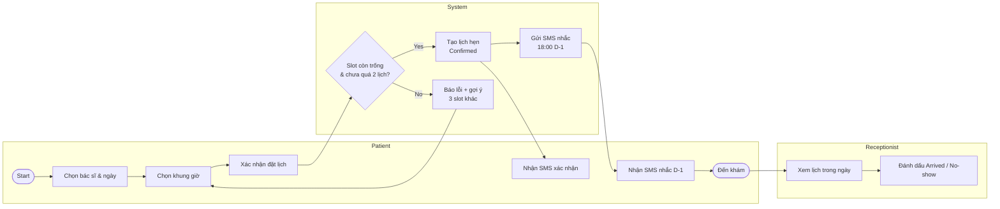
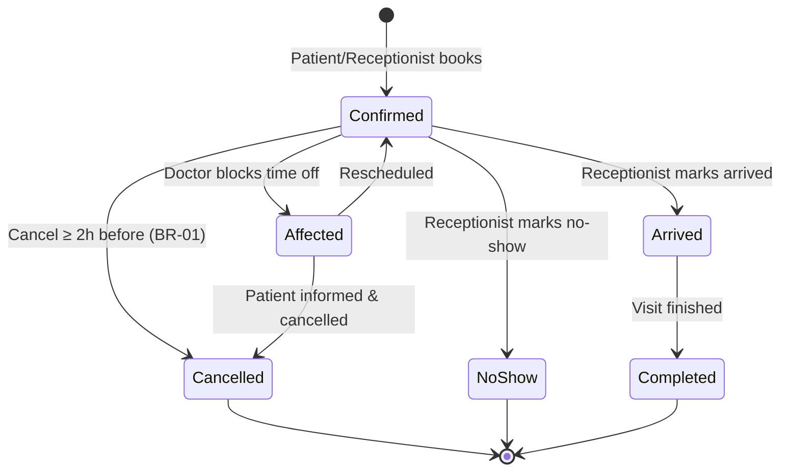
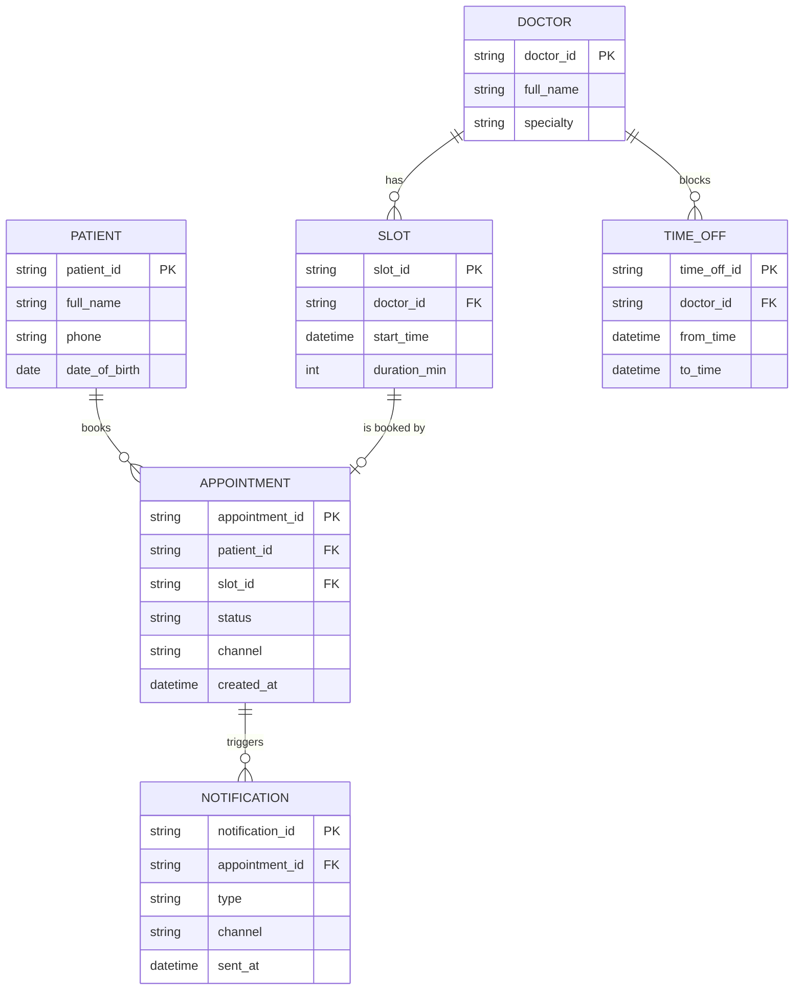


> Prompts used: *"Vẽ quy trình đặt lịch To-Be dạng swimlane"*, *"Vẽ sơ đồ trạng thái của lịch hẹn"*, *"Vẽ ERD"*

## To-Be booking process (swimlane)
**Purpose:** show stakeholders who does what after go-live. **Audience:** Clinic Manager, receptionists.

**Changes vs As-Is:** no phone call needed · double booking blocked by system · automatic reminder · attendance recorded for no-show report.

## Appointment state diagram

**Open question:** `Affected` state depends on the answer to the FR-06 clarification.

## ERD (phase 1)


