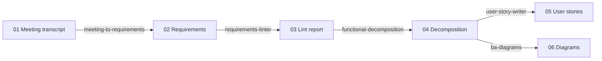

# Case study: Clinic Booking App / Ứng dụng đặt lịch khám

One fictional project, run end-to-end through the skills — each output is the input of the next step.

| Step | File | Skill |
|------|------|-------|
| 1 | [01-meeting-transcript.md](01-meeting-transcript.md) | *(input)* |
| 2 | [02-requirements.md](02-requirements.md) | `meeting-to-requirements` |
| 3 | [03-lint-report.md](03-lint-report.md) | `requirements-linter` |
| 4 | [04-functional-decomposition.md](04-functional-decomposition.md) | `functional-decomposition` |
| 5 | [05-user-stories.md](05-user-stories.md) | `user-story-writer` |
| 6 | [06-diagrams.md](06-diagrams.md) | `ba-diagrams` |

> Outputs are lightly edited for brevity. Your results will vary with the model and the context you provide.
