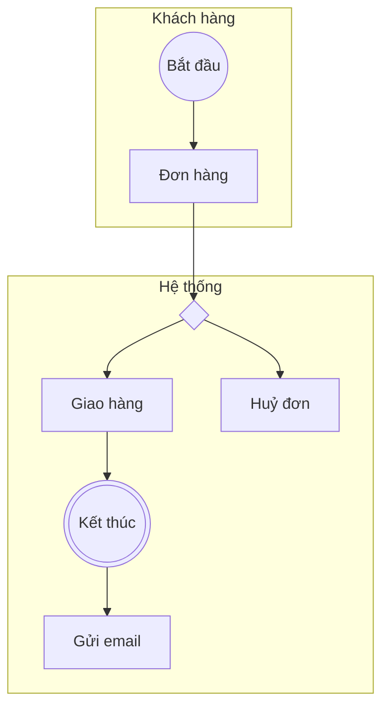

# Đề bài kiểm tra skill

Chạy từng đề trong một phiên mới có cài skill, chấm theo `expected.md`. Mỗi đề kiểm tra một khả năng chính.

## E1 · Vẽ từ mô tả ngắn (chế độ A)
> Vẽ BPMN quy trình đặt lịch khám bệnh online: bệnh nhân chọn bác sĩ và giờ khám, hệ thống giữ lịch 15 phút, bệnh nhân đặt cọc qua cổng thanh toán, phòng khám gửi xác nhận. Nếu bác sĩ huỷ lịch thì báo bệnh nhân chọn giờ khác.

## E2 · Mô tả thiếu thông tin
> Vẽ quy trình duyệt nghỉ phép.

## E3 · Collaboration nhiều bên
> Quy trình giao hàng: sàn thương mại điện tử nhận đơn, gửi yêu cầu lấy hàng cho đơn vị vận chuyển; người bán đóng gói; đơn vị vận chuyển lấy hàng, giao cho người mua, báo kết quả về sàn. Giao thất bại 3 lần thì hoàn hàng về người bán.

## E4 · Soát sơ đồ có lỗi (chế độ C)
> Soát giúp sơ đồ Mermaid này:

## E5 · AS-IS → TO-BE (chế độ B)
> Hiện tại khách nộp hồ sơ vay qua app, nhân viên tải về kiểm tra thủ công, gửi email cho trưởng phòng duyệt, trưởng phòng hay quên trả lời, khách chờ 3–5 ngày. Đề xuất TO-BE.

## E6 · Chọn ký hiệu (chế độ D)
> Khi khách không thanh toán trong 15 phút thì huỷ đơn: dùng gateway hay timer? Viền liền hay viền đứt?

## E7 · Pool hay lane
> Trong quy trình đặt xe, khách hàng, tài xế, hệ thống điều phối và ví điện tử nên là pool hay lane?

## E8 · Mô phỏng kịch bản
> Với quy trình ở E1, chạy thử các kịch bản: bệnh nhân không đặt cọc, cổng thanh toán không phản hồi, bác sĩ huỷ lịch. Kịch bản nào bị kẹt?
