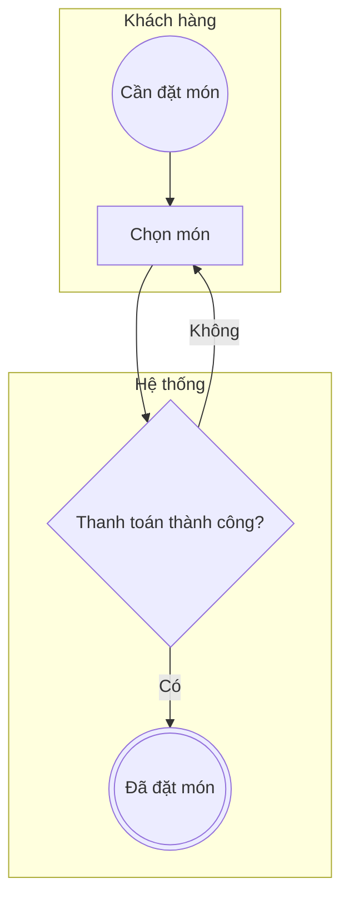

# Định dạng đầu ra

| Định dạng | Dùng khi | Ưu / nhược |
|---|---|---|
| **Bảng mô tả** (Lane \| Activity/Event \| Loại \| Điều kiện) | Đối chiếu nội dung với người vận hành | Dễ soát; không phải sơ đồ |
| **Mermaid** | Vòng nháp, workshop, dán Notion/GitHub | Sửa nhanh, xem ngay; không phải BPMN chuẩn |
| **BPMN 2.0 XML** | Vòng cuối, import Camunda/bpmn.io/BPMS | Chuẩn; cần phần toạ độ (BPMNDiagram) |
| **SVG** | Chèn tài liệu/slide, xem ngay trên trình duyệt | Đẹp, đúng ký hiệu; bố cục tự động là bản nháp |
| **Trang token (HTML)** | Review với stakeholder, đào tạo, trình bày ngoại lệ | Chọn kịch bản, xem token chạy; một file, không cần mạng |

Quy trình khuyến nghị: bảng → Mermaid (lặp) → XML + SVG (khi đã chốt nội dung) → trang token khi review.

Tất cả sinh từ **một** spec JSON:
```bash
python3 scripts/spec_to_mermaid.py   spec.json diagram.mmd
python3 scripts/spec_to_bpmn.py      spec.json diagram.bpmn && python3 scripts/bpmn_lint.py diagram.bpmn
python3 scripts/spec_to_svg.py       spec.json diagram.svg
python3 scripts/simulate_tokens.py   spec.json
python3 scripts/build_token_page.py  spec.json tokens.html
```

## Spec JSON (đầu vào của hai script)
```json
{
  "name": "Tên process",
  "lanes": [{"id": "kh", "name": "Khách hàng"}],
  "nodes": [
    {"id": "s", "type": "start", "lane": "kh", "name": "Cần đặt món"},
    {"id": "t1", "type": "user_task", "lane": "kh", "name": "Chọn món"},
    {"id": "g1", "type": "xor", "lane": "kh", "name": "Thanh toán thành công?"},
    {"id": "e", "type": "end", "lane": "kh", "name": "Đã đặt món"},
    {"id": "b1", "type": "boundary_timer", "attached_to": "t1", "interrupting": false, "name": "Sau 2 phút"}
  ],
  "flows": [
    {"from": "s", "to": "t1"},
    {"from": "g1", "to": "e", "name": "Có"},
    {"from": "g1", "to": "t1", "name": "Không", "default": true}
  ]
}
```
**type** hợp lệ:
- Event: `start`, `start_message`, `start_timer`, `end`, `end_error`, `end_terminate`, `end_message`, `timer`, `message_catch`, `message_throw`, `boundary_timer`, `boundary_message`, `boundary_error`
- Task: `task`, `user_task`, `manual_task`, `service_task`, `send_task`, `receive_task`, `script_task`, `business_rule_task`, `subprocess`, `call_activity`
- Gateway: `xor`, `and`, `or`, `event_based`

### Pool ngoài, message flow, kịch bản (tuỳ chọn)
```json
"pools":    [{"id": "pay", "name": "Cổng thanh toán", "position": "top"}],
"messages": [{"id": "mreq", "from": "t5", "to": "pay", "name": "Yêu cầu thanh toán"},
             {"id": "mres", "from": "pay", "to": "t6", "name": "Kết quả giao dịch"}],
"scenarios": [{"id": "A", "name": "Thành công", "choices": {"g1": "Có"}, "fire": [], "silent": [], "expect": "e1"}]
```
- `pools`: bên ngoài (hộp đen), `position` = `top` | `bottom`. Process chính vẫn là một pool nhiều lane.
- `messages`: một đầu là node, đầu kia là id pool. Message tới receive task/message event là thứ token phải chờ.
- `scenarios`: dùng cho `simulate_tokens.py` và `build_token_page.py` - `choices` (nhánh ở gateway: nhãn flow hoặc id node đích; list = lần qua thứ 1, 2…), `fire` (boundary kích hoạt), `silent` (message không bao giờ tới), `expect` (end mong đợi). Chi tiết: `token-review.md`.

Quy ước: `id` là chữ không dấu/không khoảng trắng; `lane` là `id` của lane (boundary không cần lane); `default: true` đánh dấu default flow (tuỳ chọn, nên có khi gateway có hơn 2 nhánh); vòng lặp (flow quay lại) được vẽ vòng dưới sơ đồ. Gateway gộp để `name` rỗng.

## Mermaid (khuôn)

Start `(( ))` · End `((( )))` · Gateway `{ }` · Task `[ ]` · lane = subgraph · pool ngoài `[[ ]]` · message flow `-.->`.

## BPMN XML tay
Nếu không dùng script, XML phải có: `collaboration` + `participant`, `process` + `laneSet` (flowNodeRef), các node với `incoming/outgoing`, `sequenceFlow`, **và** `bpmndi:BPMNDiagram` với `BPMNShape` (Bounds) cho từng node và lane, `BPMNEdge` (waypoint) cho từng flow. Thiếu phần này, công cụ sẽ không hiện hình hoặc chồng shape. Nên dùng script.

## Xem file
Kéo thả `.bpmn` vào https://demo.bpmn.io , hoặc mở bằng Camunda Modeler / draw.io (File → Import).
