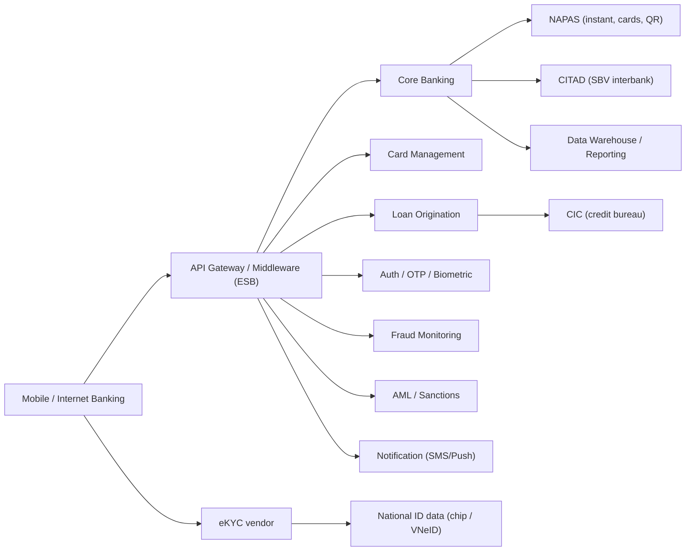

# Typical banking integration landscape

| System | Role | BA questions |
|---|---|---|
| Core banking (e.g. Temenos T24, Oracle FLEXCUBE, in-house) | System of record: CIF, accounts, postings | Which APIs exist? Batch vs real-time? EOD behaviour? Field length limits? |
| Middleware / ESB / API gateway | Orchestration, transformation | Timeout values per hop? Retry policy? Error code mapping? |
| NAPAS | Interbank instant transfers, card switching, VietQR | Response codes & timeout handling? Name inquiry service? Reconciliation file timing? |
| CITAD | Interbank payment system of the State Bank | Cut-off times? Which transfers go via CITAD vs NAPAS? |
| Card management system (CMS) | Card lifecycle, limits, authorization | Real-time lock? Who owns limits — CMS or channel? |
| LOS | Loan workflow | Integration with scoring, CIC, core for disbursement? |
| CIC | Credit information | Consent capture, inquiry fee, response time? |
| eKYC vendor | OCR, liveness, face match | Scores & thresholds? Who decides pass/fail? Data stored where? |
| Fraud / AML | Rules, screening, case management | Synchronous (block) or asynchronous (alert)? |
| Notification | SMS/OTT/push/email | Templates, masking, cost per SMS, fallback channel? |
| Data warehouse | Reporting, regulatory reports | Which new fields must flow to reports? |

## Error-handling questions for every integration
1. What is the timeout and what does the user see?
2. Is the call idempotent? How do we retry safely?
3. How are external error codes mapped to customer-friendly messages?
4. What is the reconciliation source of truth?
5. What happens if the downstream system is in maintenance?
