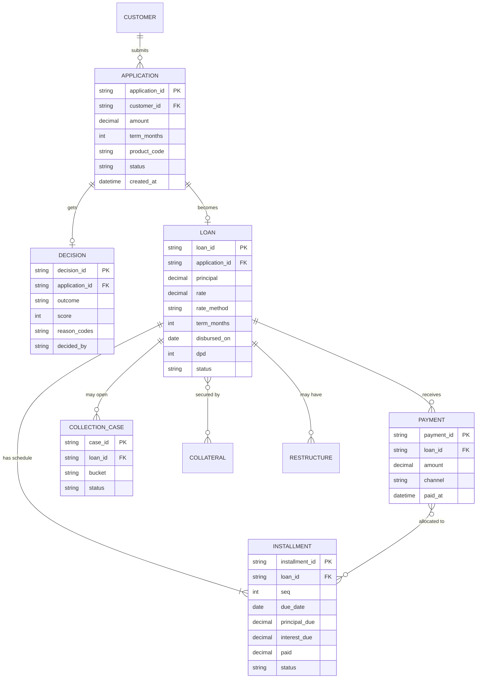

# Lending reference data model (simplified)

## Status sets to agree early
- **Application:** DRAFT · SUBMITTED · IN_REVIEW · APPROVED · REJECTED · OFFERED · SIGNED · EXPIRED · CANCELLED
- **Loan:** PENDING_DISBURSEMENT · ACTIVE · OVERDUE · RESTRUCTURED · PAID_OFF · WRITTEN_OFF · CANCELLED
- **Installment:** SCHEDULED · DUE · PARTIALLY_PAID · PAID · OVERDUE
- **Disbursement:** INITIATED · PENDING · SUCCESS · FAILED

## Data sensitivity
ID numbers, income, bureau data, contact details: personal data; mask in logs and documents; restrict access and keep audit trail.
