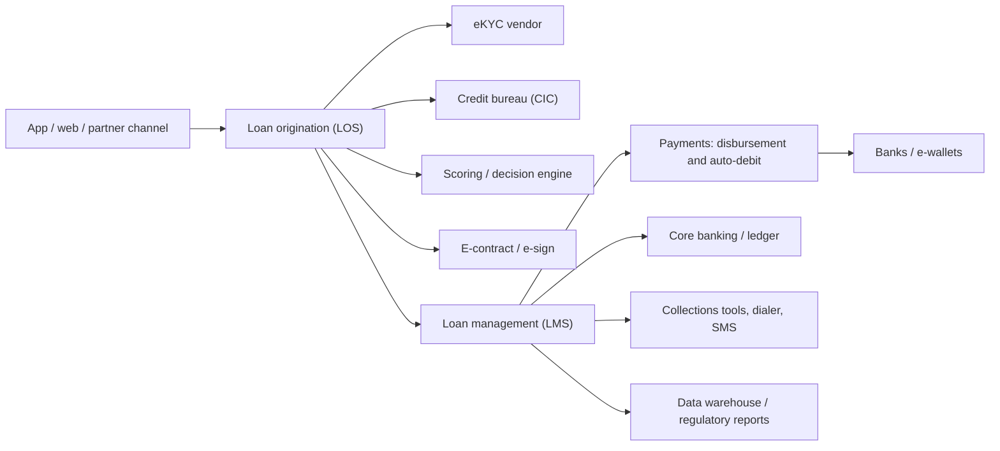

# Typical lending integration landscape

| System | Role | BA questions |
|---|---|---|
| eKYC vendor | Identity and liveness | Thresholds, retry limits, who decides pass/fail? |
| Credit bureau | Credit history | Consent capture, response time, cost, downtime fallback? |
| Scoring / decision engine | Score and rules | Rule versioning, explainability, reason codes? |
| E-sign | Contract signing | Evidence, certificate, version control? |
| Payments | Disbursement, auto-debit | Idempotent payout, failure and retry, mandate handling? |
| Core / ledger | Accounting and balances | Posting rules, daily accrual, batch window? |
| Collections tools | Contacting overdue customers | Contact limits, call recording, case assignment? |
| Reporting | Regulatory and portfolio reports | Fields, frequency, validation? |

## Questions for every integration
1. Timeout and what the customer sees? 2. Retry safe? 3. Source of truth for balance and status? 4. Error mapping? 5. Downtime fallback and manual process? 6. Reconciliation (e.g. disbursement vs bank)?
