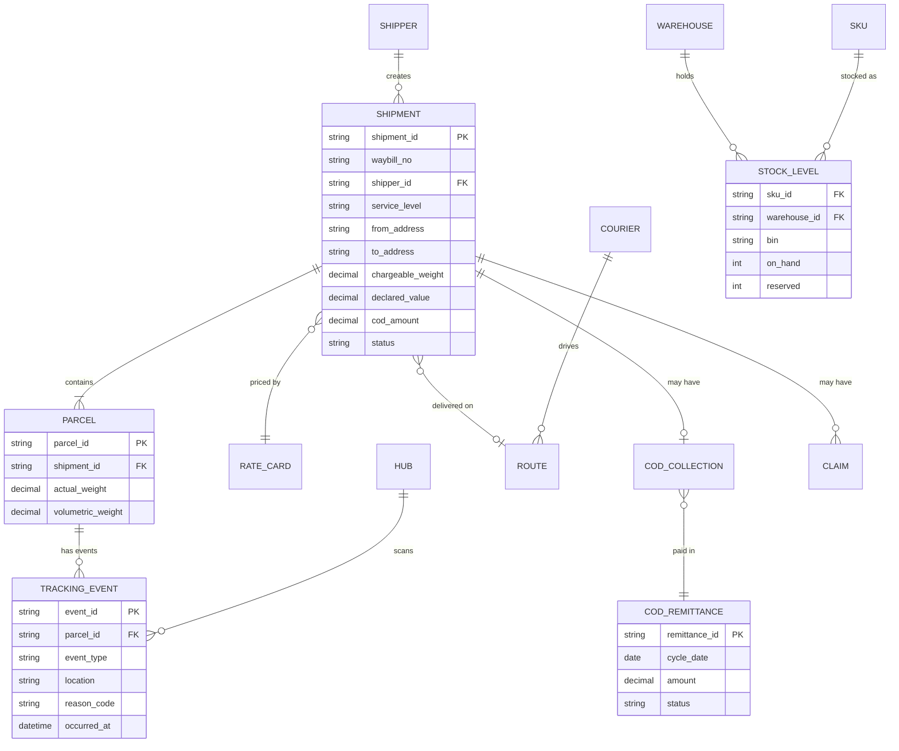

# Logistics reference data model (simplified)

## Status sets to agree early
- **Shipment:** CREATED · PICKUP_SCHEDULED · PICKED_UP · IN_TRANSIT · OUT_FOR_DELIVERY · DELIVERED · FAILED_ATTEMPT · RETURNING · RETURNED · LOST · CANCELLED
- **COD:** PENDING_COLLECTION · COLLECTED · HANDED_OVER · REMITTED · DISPUTED
- **Claim:** OPENED · EVIDENCE_REQUESTED · APPROVED · REJECTED · PAID
- **Inbound (warehouse):** EXPECTED · RECEIVING · QC · PUT_AWAY · CLOSED
- **Pick task:** CREATED · ASSIGNED · PICKED · SHORT · PACKED

> Tip: draw the shipment state diagram (`ba-diagrams`) and map each tracking event to the status it produces.

## Data sensitivity
Recipient name, phone and address are personal data: mask in notifications and logs; restrict access; define retention.
