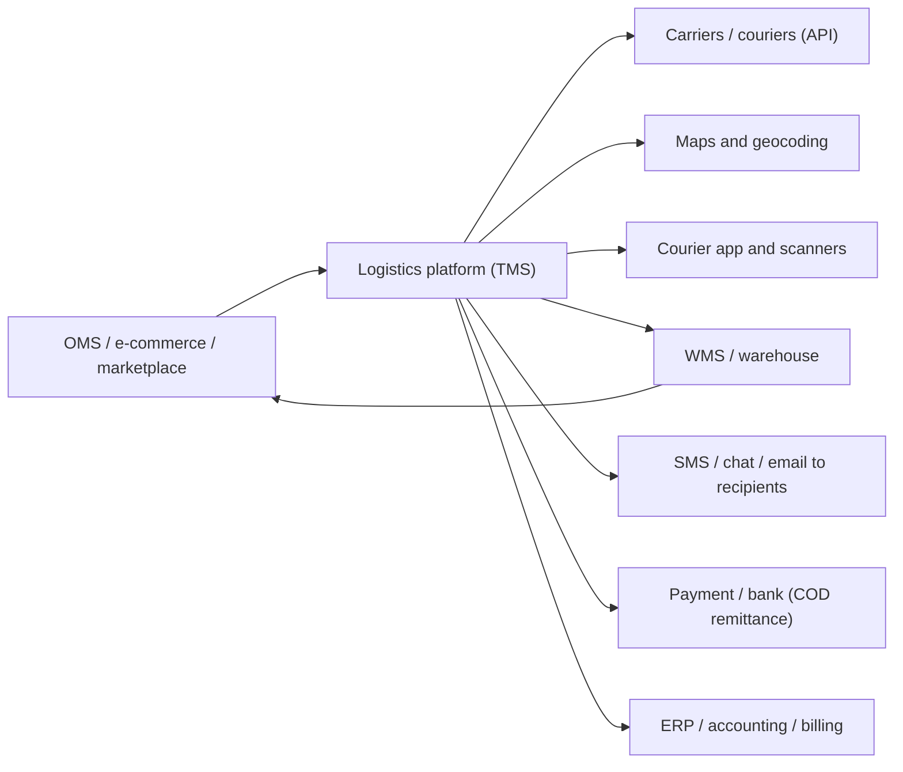

# Typical logistics integration landscape

| System | Role | BA questions |
|---|---|---|
| OMS / marketplace | Source of orders; receives status | Who owns order status? How are tracking events mapped to order statuses? |
| Carriers | Create waybill, price, track, COD | API availability, webhook vs polling, status code mapping, failure of carrier API? |
| Maps / geocoding | Address validation, routing | Confidence thresholds, administrative changes, fallback? |
| Courier app and scanners | Scan events, POD | Offline mode, scan latency, duplicate scans? |
| WMS | Stock and fulfillment | Reservation owner, stock sync frequency, source of truth? |
| Payment / bank | COD remittance | Reconciliation file format and cycle? |
| ERP / billing | Carrier invoices, shipper billing | Weight/charge reconciliation, adjustments? |

## Questions for every integration
1. Which system is the **source of truth** (stock, status, charge)? 2. Real-time, webhook or batch, acceptable delay? 3. Partner down: queue, retry, manual process? 4. Status and error-code mapping? 5. Daily reconciliation of mismatches?
