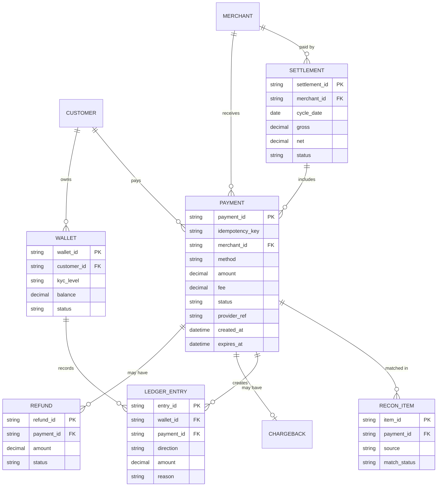

# Payments reference data model (simplified)

## Status sets to agree early
- **Payment:** INITIATED · PENDING · SUCCESS · FAILED · EXPIRED · REFUNDED · PARTIALLY_REFUNDED
- **Refund:** REQUESTED · PENDING · SUCCESS · FAILED
- **Chargeback:** OPENED · EVIDENCE_SUBMITTED · WON · LOST · CLOSED
- **Settlement:** OPEN · CLOSED · PAID · ON_HOLD
- **Wallet:** ACTIVE · LIMITED · LOCKED · CLOSED
- **Reconciliation item:** MATCHED · MISSING_INTERNAL · MISSING_PARTNER · AMOUNT_MISMATCH · STATUS_MISMATCH · RESOLVED

## Data sensitivity
Card PAN: never store raw, tokenize. Wallet/account numbers and phone: mask in logs and notifications. Keys and signatures: secrets, never in documents.
