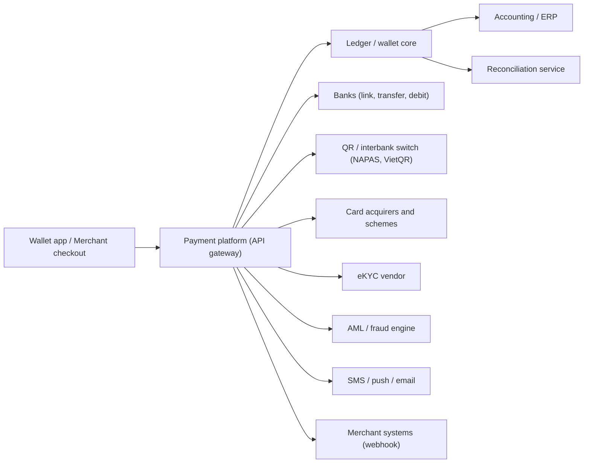

# Typical payments integration landscape

| System | Role | BA questions |
|---|---|---|
| Banks | Link, top-up, withdrawal, settlement account | Which APIs, cut-offs, error codes, reconciliation files and timing? |
| Interbank / QR switch | QR payments and transfers | Response codes, timeout and retry, dispute process? |
| Card acquirers / schemes | Card payments, chargebacks | 3DS, tokenization, authorization/capture rules, dispute deadlines? |
| eKYC vendor | Identity verification | Pass/fail thresholds, retry limits, data retention? |
| AML / fraud engine | Screening, rules | Sync (blocks) or async (alerts)? |
| Merchant webhooks | Notify merchants | Signature, retry schedule, ordering, replay? |
| Accounting / ERP | Ledger postings, invoicing | Posting rules, frequency, chart of accounts mapping? |
| Reconciliation service | Matching | Sources, keys, tolerance, break workflow? |

## Questions for every integration
1. Timeout and what the user sees? 2. Retry safe (idempotent)? 3. Source of truth for status? 4. Error-code mapping? 5. Partner maintenance and downtime behaviour? 6. How are mismatches found and fixed?
